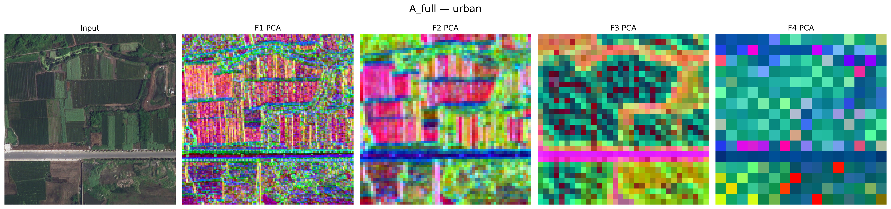
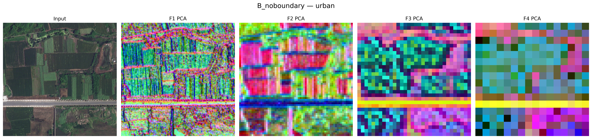
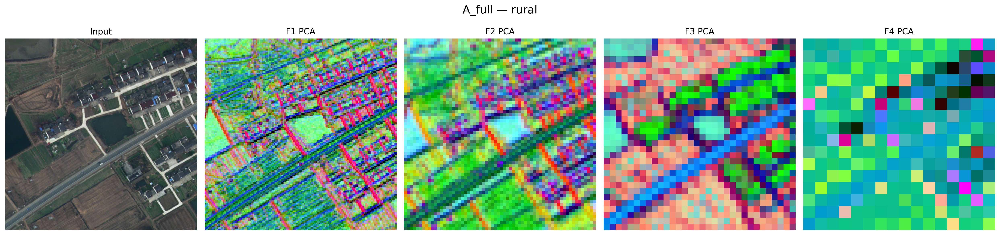
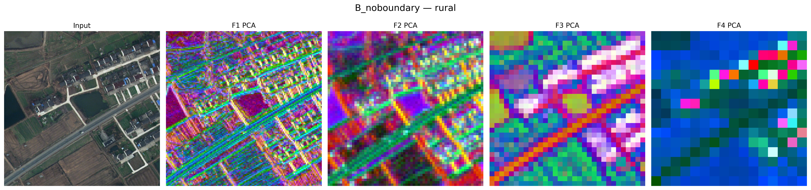
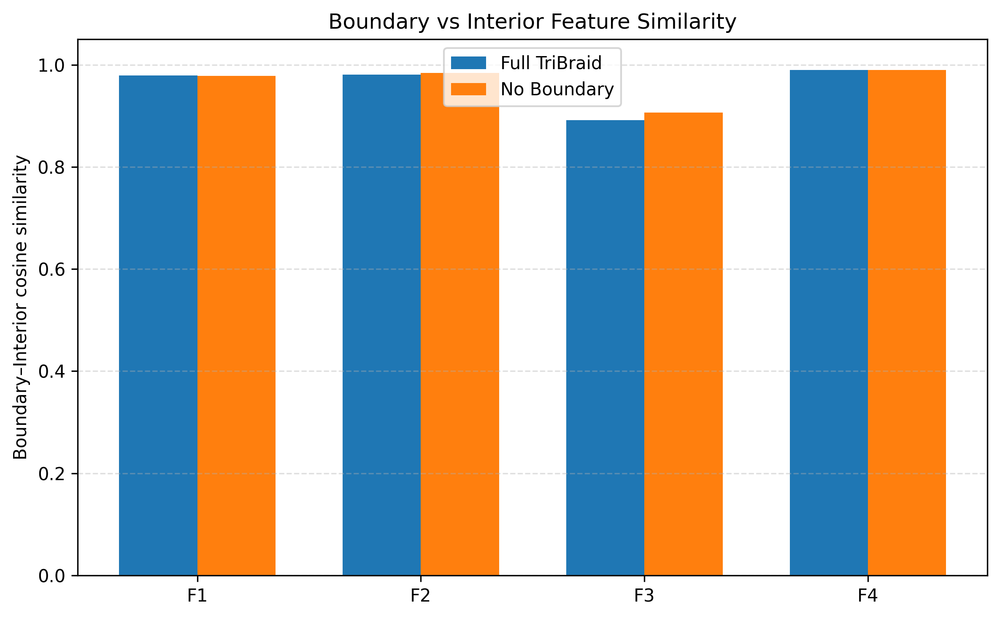

# Mamba-Segmentation Reproduction

Independent reproduction and analysis audit of:

> A Controlled Benchmark of Visual State-Space Backbones with Domain-Shift and Boundary Analysis for Remote-Sensing Segmentation

- Paper: https://arxiv.org/abs/2604.18721
- Official code: https://github.com/Dineth14/Mamba-Segmentation
- Official checkpoints: https://huggingface.co/dineth18/Mamba-Segmentation

## Summary

This repository records the independent verification of the paper's LoveDA
results and a short-budget Boundary Loss ablation. It distinguishes reproduced
results from discrepancies in the public code and checkpoints.

| Backbone | Reproduction status |
|---|---|
| VMamba-Small | Official All→All, Urban→Rural and Rural→Urban results reproduced; Boundary/Interior analysis reproduced |
| MambaVision-Base | All→All and both cross-domain results reproduced to rounding precision |
| Spatial-Mamba-Base | All→All close; cross-domain results differ from the paper |
| CNN / DeepLabv3 / ResNet-50 | Published All→All checkpoint differs substantially from the paper table |
| Transformer / UNetFormer | Published configuration actually executes a ResNet-18 CNN encoder |

The reported results are evaluation audits of published checkpoints unless a
report explicitly states that a new model was trained.

## Boundary Loss ablation

The short-budget ablation compares VMamba-Small under identical settings with
only the boundary-loss weight changed:

- A: Lovász + Focal + 0.5 × Boundary
- B: Lovász + Focal

Both runs use seed 42, batch size 4, 15,000 iterations, identical data and
augmentation.

| Metric | Full loss | No boundary | Difference |
|---|---:|---:|---:|
| Best mIoU | 54.30 | 53.84 | +0.46 |
| Best OA | 72.20 | 71.68 | +0.52 |
| Boundary mIoU | 29.12 | 28.38 | +0.74 |
| Interior mIoU | 57.46 | 57.07 | +0.39 |
| Boundary−Interior gap | 28.33 | 28.68 | -0.35 |

The multi-image feature analysis found that F3 boundary/interior cosine
similarity was 0.8911 with Boundary Loss and 0.9063 without it. This suggests
that Boundary Loss primarily increases mid-level boundary/interior feature
distinction, rather than increasing boundary activation magnitude.

### Feature visualizations

| Full loss | No Boundary Loss |
|---|---|
|  |  |
|  |  |

Raw metrics, per-image feature statistics and training logs are stored under
[`evidence/ablation_15k/`](evidence/ablation_15k/).

This is an exploratory single-seed, 15k-iteration ablation and is not a strict
replacement for a full 50k multi-seed experiment.

## Reports

- [Five-backbone summary](reports/00_five_backbone_summary.md)
- [VMamba-Small](reports/01_vmamba_small.md)
- [CNN / DeepLabv3](reports/02_cnn_deeplabv3p.md)
- [MambaVision-Base](reports/03_mambavision_base.md)
- [Transformer / ResNet-18 configuration](reports/04_transformer_unetformer_resnet18.md)
- [Spatial-Mamba-Base](reports/05_spatialmamba_base.md)
- [Boundary Loss ablation](reports/06_boundary_loss_ablation_15k.md)

## Reproducibility assets

- [Environment description](docs/ENVIRONMENT.md)
- [Step-by-step reproduction guide](docs/REPRODUCE.md)
- [Checkpoint manifest](docs/CHECKPOINTS.md)
- [Base environment requirements](requirements.txt)
- [MambaVision environment requirements](requirements-mambavision.txt)
- [Conda environment](environment.yml)
- [Machine-readable reproduction metrics](results/reproduction_metrics.csv)
- [Machine-readable cross-domain metrics](results/cross_domain_metrics.csv)
- [Boundary Loss ablation metrics](results/boundary_ablation_metrics.csv)
- [Feature similarity measurements](results/feature_quantitative.csv)
- [Upstream compatibility patch](patches/upstream_compatibility.patch)
- [Analysis scripts](scripts/)

## Important discrepancies

1. The paper states batch size 4, while the current repository default is 8.
2. The published CNN checkpoint evaluates to 52.02 mIoU, not the paper's 43.01.
3. `configs/transformer_unetformer.yaml` selects `backbone: cnn` with ResNet-18.
4. The published VMamba checkpoints do not reproduce the paper's reported
   three-seed mean and standard deviation exactly.
5. Several published cross-domain checkpoints do not reproduce the paper's
   absolute values.

These discrepancies require confirmation from the authors before a strict
full-paper reproduction can be claimed.

## Data and weights

LoveDA and ISPRS Potsdam data are not included due to size and licensing.
Model checkpoints are not included; use the official Hugging Face repository
or the links documented in the detailed reports.

## Scope

The current repository does not claim a complete end-to-end reproduction of
every table or experiment in the paper. It documents:

- which results were reproduced;
- which public artifacts are inconsistent;
- the short-budget loss ablation;
- boundary and feature-level diagnostic evidence.
